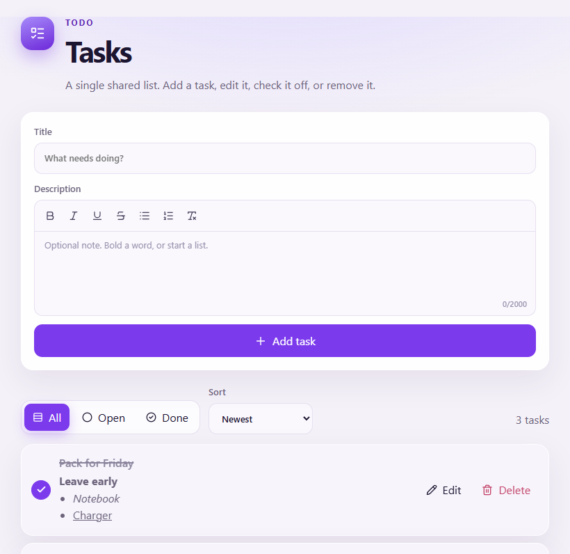
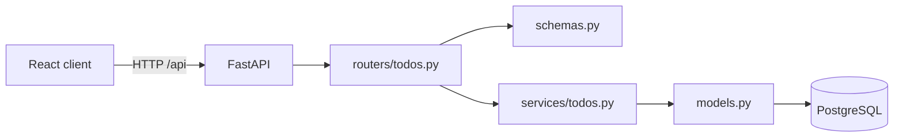
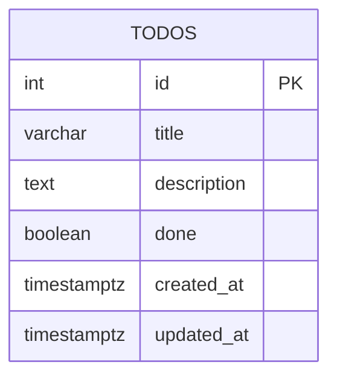

# TODO API

Backend for a small TODO app. Clients can list, filter, create, edit, complete, and delete tasks. Data is stored in PostgreSQL (or SQLite for local development) and the API is documented with OpenAPI at `/docs`.

## Layout

```text
server/     FastAPI application, migrations, and tests
client/     Optional React UI
```

Routing, request validation, and database access live in separate modules:

- `server/app/routers/todos.py` — HTTP routes
- `server/app/schemas.py` — Pydantic request and response models
- `server/app/services/todos.py` — queries and writes
- `server/app/models.py` — SQLAlchemy model

## Documentation

- [User guide](docs/user-guide.md) ([PDF](docs/user-guide.pdf))
- [Architecture and database](docs/architecture.md) ([PDF](docs/architecture.pdf))
- [User guide and architecture, one PDF](docs/TODO-API-documentation.pdf)

## Interface

The description is a notepad. Select text and use the toolbar for bold, italic, underline, strikethrough, a bullet list, or a numbered list. The formatted note is what you see in the task list.




## Architecture

The browser talks only to the React app. Vite forwards `/api` to FastAPI. Each request is validated, then handled by the service, then stored through SQLAlchemy.



Alembic owns the schema. The API reads `DATABASE_URL` from the environment and does not create tables on startup.

## Database

There is one table, `todos`. `done` and `created_at` are indexed because the list endpoint filters and sorts on them.



## Run with Docker

From this directory:

```bash
docker compose up --build
```

- UI: http://localhost:5173
- API: http://localhost:8000
- Swagger UI: http://localhost:8000/docs
- PostgreSQL: `localhost:5433`, database `todo`, user `todo`, password `todo`

Those database credentials are for local development. The API container runs migrations before it starts serving traffic. TODO rows are stored in the `todo_pg` volume, so they remain after the API container restarts.

## Run locally

Python 3.11 or newer. Setup, migrations, tests, and database notes are in [server/README.md](server/README.md). The React UI is in [client/README.md](client/README.md).

## API

| Method | Path | Success |
| --- | --- | --- |
| GET | `/api/todos` | 200 |
| GET | `/api/todos/{id}` | 200 |
| POST | `/api/todos` | 201 |
| PUT | `/api/todos/{id}` | 200 |
| PATCH | `/api/todos/{id}/done` | 200 |
| DELETE | `/api/todos/{id}` | 204 |

`GET /api/todos` accepts `done`, `limit`, `offset`, `sort`, and `order`. The list body is a JSON array. `X-Total-Count` and `X-Offset` are always set. `X-Limit` is set when `limit` is sent.

Missing todos return `404` with `{"detail": "TODO not found"}`. Invalid bodies and query parameters return `422` with `{"detail": "<what is wrong>"}`. Unexpected failures return `500` with `{"detail": "Internal server error"}` and no stack trace.

## Choices

- **FastAPI** gives typed routes and Swagger UI without a separate API spec.
- **SQLAlchemy 2** and **Alembic** keep the model, queries, and schema changes explicit.
- **PostgreSQL** is the intended database. **SQLite** is the default when `DATABASE_URL` is unset, and it is what the tests use, so the suite does not need a running database.
- Endpoints are synchronous. Each request uses one SQLAlchemy session and commits in the service, which is easy to follow for this workload.
- `PUT /api/todos/{id}` updates only `title` and/or `description`. `done` changes only through `PATCH /api/todos/{id}/done`, which toggles the current value.
- The React client in `client/` talks to the API over HTTP. Vite proxies `/api` to the backend. Completed tasks are struck through, and create, edit, toggle, and delete update the list before the response returns.
- The description notepad stores formatting as a small set of HTML tags (`strong`, `em`, `u`, `s`, `ul`, `ol`, `li`, `br`, `div`). Other tags are removed before the note is saved.

## Checks

From `server/`, with the dev extra installed:

```bash
ruff check .
ruff format --check .
mypy app
pytest
```

GitHub Actions runs those checks on Python 3.11 and 3.12.
