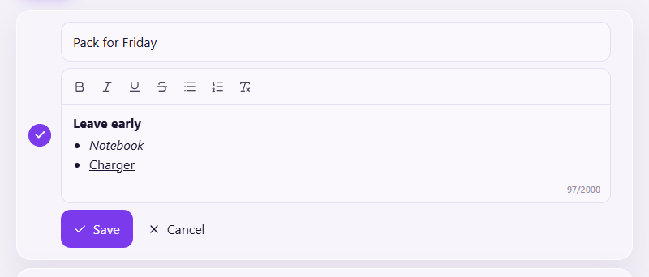
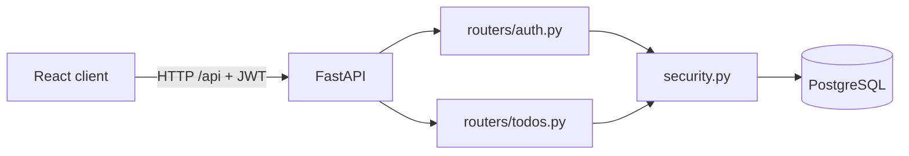
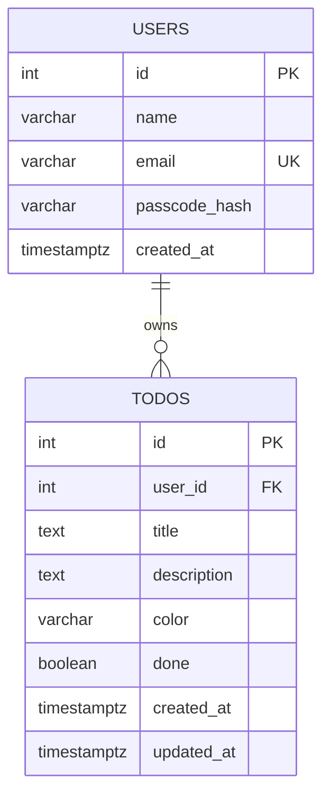

# TODO API

A small TODO app with accounts. Each person signs up with a name, email, and 6-digit passcode, then keeps notes on a sticky wall. The API checks a JWT on every task request. Titles and descriptions are encrypted in PostgreSQL. The API is documented with OpenAPI at `/docs`.

## Live demo

<p align="center">
  <a href="https://python-todo-api-ui.onrender.com" target="_blank" rel="noopener noreferrer">
    
  </a>
</p>

The hosted app is at [python-todo-api-ui.onrender.com](https://python-todo-api-ui.onrender.com). Sign up, then add, edit, search, and complete notes.

## Layout

```text
server/     FastAPI application, migrations, and tests
client/     React UI
docs/       User guide and architecture
```

Routing, request validation, and database access live in separate modules:

- `server/app/routers/auth.py` — signup, login, and passcode change
- `server/app/routers/todos.py` — task routes, each requiring the current user
- `server/app/schemas.py` — Pydantic request and response models
- `server/app/services/` — account and task rules
- `server/app/security.py` — passcode hash, JWT, and note encryption
- `server/app/models.py` — SQLAlchemy models

## Documentation

- [Server setup, migrations, tests, and limits](server/README.md)
- [Client setup and limits](client/README.md)
- [User guide](docs/user-guide.md) ([PDF](docs/user-guide.pdf))
- [Architecture and database](docs/architecture.md) ([PDF](docs/architecture.pdf))
- [User guide and architecture, one PDF](docs/TODO-API-documentation.pdf)
- [Swagger UI](https://python-todo-api.onrender.com/docs) for the hosted API

## Interface

Log in, then use **Sticky wall** or **New task**. Notes are colored cards. Open a card to read the full text. The description is a notepad: bold, italic, underline, strikethrough, and lists. The account menu on your name has **Change passcode** and **Log out**.




## Architecture

The browser talks only to the React app. Vite forwards `/api` to FastAPI. The API checks the JWT, encrypts note text, then stores it through SQLAlchemy.



Alembic owns the schema. The API reads `DATABASE_URL` from the environment and does not create tables on startup.

## Database

`users` holds the account. `todos` holds that account's notes. `passcode_hash` is a bcrypt hash. `title` and `description` are ciphertext.



## Run with Docker

From this directory:

```bash
docker compose up --build
```

- UI: http://localhost:5173
- API: http://localhost:8000
- Swagger UI: http://localhost:8000/docs
- PostgreSQL: `localhost:5433`, database `todo`, user `todo`, password `todo`

Those database credentials are for local development. The API container runs migrations before it starts serving traffic. Accounts and notes are stored in the `todo_pg` volume, so they remain after the API container restarts.

## Run locally

Python 3.11 or newer. Setup, migrations, tests, and database notes are in [server/README.md](server/README.md). The React UI is in [client/README.md](client/README.md).

## API

The hosted API is [https://python-todo-api.onrender.com](https://python-todo-api.onrender.com). Swagger UI is at [https://python-todo-api.onrender.com/docs](https://python-todo-api.onrender.com/docs).

| Method | Path | Success |
| --- | --- | --- |
| POST | `/api/auth/signup` | 201 |
| POST | `/api/auth/login` | 200 |
| GET | `/api/auth/me` | 200 |
| POST | `/api/auth/passcode` | 204 |
| GET | `/api/todos` | 200 |
| GET | `/api/todos/{id}` | 200 |
| POST | `/api/todos` | 201 |
| PUT | `/api/todos/{id}` | 200 |
| PATCH | `/api/todos/{id}/done` | 200 |
| DELETE | `/api/todos/{id}` | 204 |

Todo routes, `/api/auth/me`, and `/api/auth/passcode` require `Authorization: Bearer <token>`. `GET /health` is public.

`GET /api/todos` accepts `done`, `limit`, `offset`, `sort`, and `order`. The list body is a JSON array of the current user's notes. `X-Total-Count` and `X-Offset` are always set. `X-Limit` is set when `limit` is sent.

Missing todos return `404` with `{"detail": "TODO not found"}`. Invalid bodies and query parameters return `422` with `{"detail": "<what is wrong>"}`. Unexpected failures return `500` with `{"detail": "Internal server error"}` and no stack trace.

## Choices

- **FastAPI** gives typed routes and Swagger UI without a separate API spec.
- **SQLAlchemy 2** and **Alembic** keep the model, queries, and schema changes explicit.
- **PostgreSQL** is the intended database. **SQLite** is the default when `DATABASE_URL` is unset, and it is what the tests use, so the suite does not need a running database.
- Endpoints are synchronous. Each request uses one SQLAlchemy session and commits in the service.
- Passcodes are hashed with bcrypt. Access tokens are JWTs. Note text is encrypted with Fernet using a server key, so the database does not hold the plaintext title or description.
- `PUT /api/todos/{id}` updates only the title, description, and color fields that were sent. `done` changes only through `PATCH /api/todos/{id}/done`, which toggles the current value.
- The React client stores the token in the browser and attaches it to `/api` calls. Vite proxies `/api` to the backend.

## Checks

From `server/`, with the dev extra installed:

```bash
ruff check .
ruff format --check .
mypy app
pytest
```

GitHub Actions runs those checks on Python 3.11 and 3.12.
